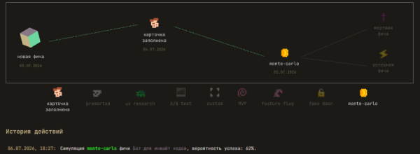
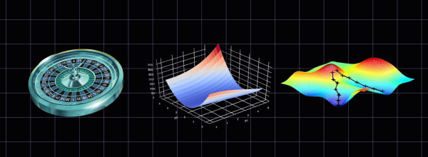

### Hi, I'm Yury 👋

- ⚙️ Product Owner with 8 years of experience in IT.
- 6 years in EdTech, from startups to corporations: Sber Education, products for Alfa-Bank and MKB.
- 🛠️ Currently building [Feature Killer](https://featurekiller.ru/) - scoring a feature's odds before it ever reaches a sprint.
- 🎓 Author of large education programs: an MSc for Product Managers at ASU University, an AI Agents course for the Moscow Department of Education and Science, and the Alfa-Future Internship at Alfa-Bank.
- 🕹 Inventor of study game jams for kids. Helped young students launch 140+ games.

## Bio

Born in Moscow. Eight years of shipping products, from my own startups to a corporate portfolio. Expert in gamification and UX. Obsessed with psychology and decision-making.

- 2015. Bachelor's degree, Law, Moscow State Industrial University (MSIU)
- 2020. Neural Network Technologies course, MIPT
- 2021 - 2025. Product training: School of Education, Product Star, AJTBD by Ivan Zamesin
- 2020 - 2022. Worked as a Product Manager @ NextED
- 2022 - 2023. Launched a startup, Boundless Education
- 2023 - 2024. Worked as a Product Manager @ [Phoenix Education](https://www.phoenix.education)
- 2023 - 2026. Worked as a Product Owner @ [Rocket Tech School](https://www.rts.school/en)
- 2025 - 2026. Worked as a Product Owner @ Sber Education
- 2026 - now. Building my own products, open to new projects

## 🛠️ Pet projects

### [Feature Killer](https://featurekiller.ru/)

A weak hypothesis reaches the sprint far too often, because the most confident voice in the room brought it. Saying no in that meeting, without numbers, almost never works. [Feature Killer](https://featurekiller.ru/) scores the hypothesis before development: product context, 100,000 simulations, a premortem, a KILL or GO verdict, the top three reasons it fails, and what to test this week instead of a sprint.

### [AI Agent Skills for PMs](https://yurymikhno.ru/projects/ai-agent-skills-pm.html)

Four skills that turn an AI agent into a strict analyst of product hypotheses. A normal model mirrors the way a person phrased the question. That is a bad advisor for backlog grooming: it agrees, it does not calculate.

## 🤝 Connect with me

   
